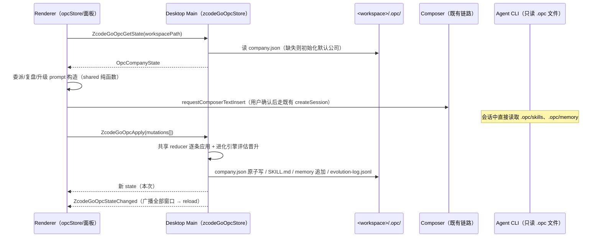

# OPC 模式（AI 原生公司界面模式）

## 背景与定位

OPC 是继「编程（coding）」「办公（office）」之后的第三个界面模式（`InterfaceMode`），
把 zcode-go 从「一个助手」升级为「一家 AI 原生公司」的操作台。设计理念吸收自两个上游项目：

- **HKUDS/OpenOPC**：个人 AI 原生公司（Self-Built / Self-Run / Self-Grown）。
  借鉴其组织模型（公司 → 岗位 → 角色员工）、看板工作项状态机、人才市场模板
  （5 字段 frontmatter：name/description/color/emoji/vibe）以及**自成长（RSI）闭环**：
  执行 → 复盘 → 经验归因到角色 → 蒸馏为私人记忆 → 重复出现的经验自动晋升为共享 playbook 技能。
- **alirezarezvani/claude-skills**：技能包格式（SKILL.md frontmatter：name/description/
  metadata{version,category,...}，正文工作流 + references/assets）与「description 写清触发
  时机」的编写规范。OPC 的技能库直接兼容该格式，可从其仓库目录批量导入。

硬性约束：**不修改 CLI（apps/zcode-cli）与官方协议方法**。OPC 的执行链路完全复用既有
会话通道（UI → SessionPane → createSession → CLI）；技能与记忆以工作区文件（`.opc/`）承载，
CLI agent 通过普通文件读取即可消费——RSI 闭环经由文件系统闭合，不经协议。

## 产品规则

1. 界面模式三态：`coding | office | opc`，切换入口与既有模式一致（账户菜单 / 设置页 /
   Onboarding）。OPC 模式下：
   - 草稿空态以「公司驾驶舱」替代问候语空态（公司概览 + 看板摘要 + 快捷操作）；
   - 办公模式推荐提示区不再渲染（OPC 有自己的行动入口）；
   - 全局「公司面板」可随时打开（App 挂载一次，事件 `zcode-go:opc-open` 唤起），
     含七个标签页：看板 / 组织 / 人才市场 / 技能 / 进化 / 办公室地图 / 模型。
2. 公司状态是**每工作区**一份，持久化在 `<workspacePath>/.opc/`：
   ```
   .opc/
     company.json            # 唯一结构化事实源（公司/岗位/员工/工作项/经验/技能元数据/进化日志）
     templates/roles/*.md    # 导入的角色模板（OpenOPC 五字段格式；内置模板不入盘）
     skills/<skillId>/SKILL.md   # 技能正文（内置/导入/晋升同构）
     memory/<employeeId>.md      # 员工私人经验档案（追加式）
     evolution-log.jsonl         # 进化事件镜像（追加，便于人读/外部工具消费）
   ```
3. 工作项状态机：`backlog → ready → in_progress → review → done`（侧向 `cancelled`）。
   状态流转由 reducer 校验，任意跳转仅允许沿状态机或回退到 `backlog`。
   - **依赖就绪门控（runnability）**：`ready → in_progress` 仅当全部 `dependsOn`
     前置为 done/cancelled（悬空 id 视为已解决，避免删除依赖造成死锁）；backlog→ready
     不受限（规划自由）。委派按钮同规则门控（仅 ready 态可委派）。
   - **依赖传播**：前置项变为 done 时，`backlog` 中的被依赖项若已全部就绪，自动升到
     `ready`（静默，无事件），实现「独立项并行、依赖项等待」的最小语义。
   - **升级上报（escalation）**：工作项可 `escalate`（记 escalatedAt + 说明，进化事件
     留痕）；升级项在看板徽标并计入「待所有者处理」；`resolveEscalation` 支持
     `resume`（解除）与 `takeover`（解除并转派给创始人执行）。
   - **升级团队内路由（先直属上级，再团队，后所有者）**：升级候选首位是
     当前负责人的**直属上级**（岗位汇报线 parentRoleId 链上的在职员工，
     reason=direct-manager）；其后是同类目在职同事（按完成数排序，排除
     当前负责人与创始人）——`workitem.transfer` 转派并留进化事件；无合适
     候选或团队内解决不了，才升级给所有者。
   - **汇报线层级**：`role-slot.create` 支持携带 parentRoleId（上级岗位 id，
     上级可同批创建——org 生成按预生成 id 引用；悬空引用落为顶层）；
     `slot.remove` 时子岗位提升为顶层避免渲染死链；组织页员工卡展示
     「汇报给 <上级>」；org 生成 JSON 的 slots 支持对象形式
     `{ title, parent }` 表达汇报线。
   - **返工（rework）**：review 态工作项可退回 in_progress 并落 `reworkNotes`
     （追加式）；委派 prompt 注入「返工意见（必须逐条解决）」，闭环 rework 循环。
   - **整合（integrate）**：done 且存在被依赖项时，可一键生成整合 prompt
     （注入 composer，面向下游负责人说明产出与后续动作）。
   - **架构-only 导出/导入**：以 OpcOrgDraft JSON（slots + hires 编制计划）为
     载体，仅携带编制不含工作项/经验——组织页一键导出/导入（导入走
     buildOpcOrgMutations 的 merge-fill 去重语义）。
4. 招聘（Self-Built）：从人才市场模板一键实例化员工（含内置 24 角色 + 导入模板 +
   自定义），或先建岗位再招人；员工可暂停/离职（离职不删历史经验）。
   **新员工入职即继承全部共享 playbook 技能**（tombstone 中已删的不继承）——
   晋升技能是组织资产而非个人所有（OpenOPC 语义）。
   - **组织智能**：「按目标生成架构」——把生成 prompt 注入 composer，agent 输出
     ```opc-org 围栏 JSON（slots/hires），粘贴回弹窗解析预览后一键应用（岗位去重、
     模板按名称匹配内置/导入库，未命中按自定义招聘）；另内置 corporate 预设一键应用。
     招聘对话框对同模板的暂停/离职员工给出「复用」建议（改状态而非重复招聘）。
     ```
   - **权限边界（prompt 级 + 会话级双层）**：员工携带 permissionLevel
     （read-only / workspace-write / full-access，缺省 workspace-write），
     招聘时选择、组织卡片徽标展示、委派 prompt 注入「权限边界（必须遵守）」
     章节——read-only 禁止任何写操作、workspace-write 限定工作区内、
     full-access 的破坏性动作仍须升级所有者。
     **会话级硬约束（编排器路径）**：无界面派发是我们创建的会话——sendPrompt
     按 permissionLevel 注入 toolDenylist（read-only 拒文件写家族+shell+todo
     写（TodoRead 只读豁免）、workspace-write 拒 shell 与 node-repl 家族
     （任意 eval 等同越界执行通道）、full-access 不拒；工具家族取自 shared
     tool-identity），agent 侧物理不可调用被拒工具。手动 composer 路径归用户
     控制，仍为 prompt 级——两条路径的双层边界如实记录。
   - **员工级模型偏好**：员工可绑定 providerId/modelId（原版「角色检查器
     首选 agent」思想）——编排器派发经 sendPrompt.modelSelection 传递，
     强模型做难活、轻模型做日常；与模型指纹联动（指纹条目列出受影响
     员工），组织页员工卡展示模型徽标。
   - **Office 办公室地图**：公司面板第六标签——在职员工以桌位卡呈现（创始人
     独立办公桌），状态环实时反映工作负载：执行中（蓝）/ 待验收（琥珀）/
     升级中（红）/ 空闲；点选员工展开详情（当前工作项 + 复盘入口）。

     ```

     ```

5. 执行（Self-Run）：工作项「委派」把角色模板正文 + 挂接技能 + 工作项上下文合成为
   委派 prompt，经既有 `requestComposerTextInsert` 注入 composer，由用户确认发送
   （不自动发送，不绕过既有会话准入）。完成的判定与推进由用户驱动。
   - **项目级复盘**：复盘支持全员维度——生成 prompt 列出在职员工与近期工作项，
     agent 输出的 opc-lessons 可带 employee 归属字段；解析后按员工分组，
     逐人 retro.record 落账（归属不明的记到创始人）。
6. 自进化（Self-Grown / RSI）：
   - 复盘入口产出结构化经验（statement + tags）。两种来源：手工填写；或「生成复盘」
     按钮把复盘 prompt 注入 composer，agent 输出 ```opc-lessons 围栏块，粘贴回弹窗解析。
   - 同一归一化经验指纹（statementKey）出现在 **≥2 次独立复盘**时，自动晋升为共享
     playbook 技能（`playbook-<slug>`，origin=promoted），并自动挂接到该员工的 skillRefs；
   - 此后该指纹每再确认一次，技能版本 +1 并追加 changelog；
   - 委派 prompt 会注入角色挂接的技能正文，晋升产物自下一次执行起生效——闭环成立。
   - 技能升级：任意技能可发起「迭代升级」prompt（注入当前正文让 agent 重写），新正文
     粘贴回弹窗后版本 +1、changelog 追加，落盘 SKILL.md。
7. 技能/角色模板导入：兼容两种上游格式——OpenOPC talent 目录（`*.md`，五字段
   frontmatter）与 claude-skills 目录（递归发现 `SKILL.md`）。导入即解析入
   company.json / skills/，重复 id 以「版本覆盖」处理（正文与元数据更新，changelog 追加）。

## 模板包（packs）：dev/打包期注入，开箱即用

内置 24 角色 + 16 技能只是精编底座；两个上游仓库的全量内容（OpenOPC talent 全量角色
（上游已扩至 189，pack 拉 HEAD 自动跟随）+ 仓库级技能、claude-skills 全部
SKILL.md 及其同目录文本资产）通过「模板包」机制注入，
本 git 仓库零内容入库：

1. **来源（用户 fork）**：默认 `HighCWu/OpenOPC` 与 `HighCWu/claude-skills`
   （env `OPC_PACK_OPENOPC_REPO` / `OPC_PACK_CLAUDE_SKILLS_REPO` 可覆盖）。
2. **拉取脚本**：`pnpm opc:fetch-packs`（落 `~/.zcode-go/opc-packs/<pack>/`，
   用户级缓存）与 `pnpm opc:fetch-packs:desktop`（落
   `packages/desktop/build/opc-packs/`，供打包，`.gitignore` 排除）。
   下载 codeload tarball（HEAD），按内容过滤——OpenOPC 取
   `.opc/prompts/talent/**` 与 `.opc/skills/**`，claude-skills 取全部——并写
   `pack.json` 版本戳（repo/ref/commit/fetchedAt）。技能目录内的文本资产
   （scripts/references/assets 等）随 SKILL.md 一并落盘到 skills/<id>/ 下
   （SKILL.md 以相对路径引用它们，不随包则技能不可用）。
   幂等：版本戳相同则跳过，`--force` 强制重拉。
3. **打包注入**：electron-builder extraResources 增加存在性门控条目
   （`build/opc-packs` 存在才进包，到 `resources/opc-packs`），不打包时零足迹。
4. **运行时解析链**（desktop main）：`process.resourcesPath/opc-packs`（打包态）
   → env `ZCODE_GO_OPC_PACKS_DIR` → `<appPath>/build/opc-packs`（dev）→
   `~/.zcode-go/opc-packs`。取第一个存在的目录集合。
5. **同步语义（幂等填充）**：工作区状态初始化/读写时惰性同步——按 pack 版本戳
   （company.json 新增可选字段 `packImports[packId]`）判断，未同步过则解析包内
   文件并**只创建缺失项**（技能/角色按 id 去重：已存在的一律跳过，不覆盖用户
   改动、不递增版本、不刷 changelog），随后盖版本戳。纯逻辑在 shared
   `applyOpcPackFiles`（输入虚拟文件集，可测），main 只做目录读取与落盘。
6. **插件 url-zip 发行链**：官方插件安装器拒绝 `.gitmodules` 仓库且无安装期脚本；
   对市场条目 url 来源的分发规则是「`type:"zip"` 才走 zip 安装器，sha256 必填且
   下载后强校验，无 type 一律按 git URL 克隆」（bundle `Jdt` 实证）。因此市场分发为
   **固定 tag 的 release zip + 逐版本改写市场清单**：`.github/workflows/release-plugin.yml`
   拉取 packs 注入 `plugin/opc-packs/`（gitignore，零入库）打 zip 发到 `plugin-v<版本>`，
   并把根 marketplace.json 条目改写为 `{source:"url",type:"zip",url,sha256}` 后推送。
   未发布前清单保持 `"plugin"`（仓库目录）——市场此刻无 packs，属已知降级。插件 cjs
   的 takeover / `packs` 子命令把插件内置包**镜像**到 `~/.zcode-go/opc-packs`
   （按 pack.json.fetchedAt 单调判断：旧包永不覆盖新缓存，防降级）。
7. **本地开发惰性拉取**：直挂仓库的插件目录无 packs，`packs` 子命令/接管时检测
   用户缓存为空且本仓库可得 → 后台 detached 跑 fetch 脚本（fire-and-forget，
   失败静默降级为内置模板），毫秒级返回不阻塞接管。
8. **`/opc` 只读命令**：插件 hook 拦截 `/opc`（原始/展开两种形态），直读
   `<工作区>/.opc/company.json` 打印摘要（公司/在职员工/看板计数/待处理升级/
   最近进化事件）。零模型 token；**只读**——公司状态唯一写路径仍是桌面 main。
9. **入站队列（渠道中立的 ingest）**：`<工作区>/.opc/inbox/*.json` 是对外投递
   契约——任何集成（飞书 bot worker、脚本、curl、其他 agent）都可投放
   `{ title, detail?, priority?, source?, receivedAt }` 文件。桌面 main 在
   GetState 时扫描入 `inbox` 列表（不进 company.json，非状态事实）；面板
   「待处理入站」对话框逐条 **转为工作项**（走 workitem.create 正规写路径）
   或 **忽略**（删文件）。安全约束：消费只接受纯文件名（拒绝路径分隔符），
   目录与状态写入仍归 main 单写者。插件 `/opc add <标题>` 是第一接入方
   （会话消息即投递，零 token）。
   - **Telegram 渠道桥（第一真实渠道 worker）**：`zcodeGoOpcChannels.ts`（新文件，
     desktop main 常驻伴生）——仅当 `~/.zcode-go/config.json` 配置
     `channels.telegram.{botToken, workspacePath, allowFrom[], apiBase?}` 才启动
     10s 长轮询；消息经白名单过滤（**deny-by-default**，allowFrom 空 = 全拒）后
     投递入站队列（offset 持久化，重启不重放）；面板照常审批转工作项。
     官方 bots 基建（services/bots）路由 bot 会话，与本桥独立不冲突。
10. **Office 像素质感**：桌位卡对执行中员工做像素风微动画（bob），像素级
    精灵（Phaser/贴图）仍为可选彩蛋。
11. **编排器（Self-Run 自动派发，desktop-continuous）**：看板「🚀 一键编排」
    把全部就绪且已分配的工作项经 IZCodeTaskService 无界面派发为后台会话
    （createTask v4Create + deferPersistenceUntilFirstPrompt + sendPrompt——
    bots/automation 同款执行器；并发上限 3，desktop-continuous 链路），
    派发即 in_progress（逐项即时落账；sessionId 幂等锚——已派发项永不重派；
    并发按「in_progress 且有 sessionId」计数门控）。opc-done 完成标记携带
    返工轮次后缀（`:r<n>`），watcher 去重键由标记轮次决定——返工后旧标记
    不再误推。门控：AppSettings.zcodeGoOpcAutoOrchestrate（默认启用，
    ZCode Go 设置页开关）。如实边界：opc-done 完成检测只覆盖有面板的会话，
    headless 会话的完成判定仍为人工（任务列表验收）。

## 所有权与边界

- **事实源（唯一所有者）**：desktop main 进程 `zcodeGoOpcStore.ts`。全部文件 IO 在 main，
  写入一律「tmp 文件 + rename」原子替换；JSONL 只追加。
- **UI 侧 `opcStore.ts`（Zustand）只是投影缓存**：任何变更必须走 IPC `ZcodeGoOpcApply`；
  main 应用成功后广播 `ZcodeGoOpcStateChanged`，所有窗口整体 reload，不做局部 merge
  （避免双写路径）。
- **纯逻辑（解析器 / 状态机 / 进化引擎 / prompt 构造）全部在 `packages/shared/src/opc/`**，
  零 IO、零跨包依赖；main（持久化）与 ui（展示/构造 prompt）共用。
- **依赖方向**：ui → shared；desktop → shared。UI 不直接碰 fs；main 不碰 React。
- IPC 通道键按既有 zcode-go 历史形态在 `channels.ts` 纯新增（含 payload 映射表条目）。
- 对上游文件的触碰收敛为门控点（见「上游足迹」），统一 `// zcode-go：` 锚。



## 上游足迹（门控点清单）

| 上游文件                                              | 形式                                                |
| ----------------------------------------------------- | --------------------------------------------------- |
| packages/ui/src/lib/interfaceMode.ts                  | 类型联合扩展 + normalize opc 直通（类型不可避免类） |
| packages/ui/src/store/index.ts                        | 跨窗口广播 guard 增加 `"opc"`（1 处条件扩展）       |
| packages/ui/src/WorkspaceSidebarFooter.tsx            | +1 行 RadioItem                                     |
| packages/ui/src/settingsPageHelpers.tsx               | +1 行 SelectItem                                    |
| packages/ui/src/onboarding/occupationOptions.ts       | modeOptionIcons +1 行图标                           |
| packages/ui/src/onboarding/OnboardingModeSelector.tsx | 数组字面量 +`"opc"`（1 处）                         |
| packages/ui/src/v4/SessionPane.tsx                    | 草稿空态门控分支 + 建议提示条件加 `!isOpcMode`      |
| packages/ui/src/App.tsx                               | +1 行 `useZcodeGoOpcPanel()`                        |
| packages/shared/src/channels.ts                       | +4 通道键 + payload 映射条目（纯新增）              |
| packages/shared/src/index.ts                          | +1 行 `export * from "./opc/index.js"`              |
| packages/desktop/src/main/index.ts                    | +1 import 行 + +1 init 调用行                       |

preload 增补落在 zcode-go 自己的 `zcodeGoEntries.ts`（非上游文件）。其余实现全部为新文件：
`packages/shared/src/opc/*`、`packages/desktop/src/main/zcodeGoOpcStore.ts`、
`packages/ui/src/store/opcStore.ts`、`packages/ui/src/opc/*`、文案进
`zcode-go-{zh-CN,en-US}.ts`。

## 验收场景

1. 切到 OPC 模式：侧栏菜单/设置页/Onboarding 三处均可见并可选「OPC 公司模式」；
   localStorage 与跨窗口广播对 `opc` 值成立（第二窗口同步切换）。
2. OPC 草稿态渲染公司驾驶舱（首访自动初始化默认公司：创始人 + 空 lambda）；
   非 OPC 模式下草稿空态与上游完全一致（回归零变化）。
3. 人才市场一键招聘内置角色 → 组织页出现员工；发布工作项 → 看板流转
   backlog→ready→in_progress→review→done 全程合法，非法跳转被拒绝。
4. 工作项「委派」后 composer 出现含角色正文、技能与验收标准的委派 prompt。
5. RSI 闭环：同一员工两次复盘出现同指纹经验 → 技能页自动出现
   `playbook-*`（origin=promoted，v1+changelog），员工 skillRefs 自动挂接；
   第三次再确认 → 版本升 v2 并追加 changelog。
6. 技能升级流：注入升级 prompt → 粘贴新正文 → 版本 +1、SKILL.md 落盘、changelog 追加。
7. 导入：指向 OpenOPC `.opc/prompts/talent/` 风格目录 → 角色模板入市场；
   指向 claude-skills 风格目录 → 递归导入 SKILL.md 为技能（名称冲突按版本覆盖）。
8. 持久化：重启后状态完整；company.json 损坏时面板报错可重建，不崩溃主流程。
9. 纯函数单元测试：frontmatter 解析（两种格式 + 容错）、状态机、晋升引擎
   （2 次阈值、版本递增、挂接）、委派/复盘/升级 prompt 构造。

## 模型指纹（Model Fingerprint）：同 ID 模型变动的检测与提醒

**问题**：同一模型 ID 下，提供商可能按算力/用量静默路由到不同底层模型
（"挂羊头卖狗肉"）。OPC 员工的能力/委派 prompt 是对当时模型拟合的——
模型换了，旧 prompt 的产出质量可能静默劣化。方法吸收
ToseaAI/llm-fingerprint-detector（一词回答分布 + JSD 三带判定，论文
"One Token Is Enough" 的独立实现）与 xqy2006/ModelTrace（长整数挑战、
闭集归因——自比对场景不引入其候选库）。

1. **探测电池（probe battery）**：8 个核心格（任务×语言）：1–100 随机数
   （en/zh）、随机颜色、随机字母、抛硬币、随机城市、随机动物、最爱数字。
   每格内置改写池（en/zh 各若干变体），采集时轮换改写——没有可被网关
   特判的魔法字符串。**不依赖模型自述身份**（不可靠），只用行为统计。
2. **采集**：UI 侧经 IZCodeTaskService 无界面派发（编排器同款执行器）——
   每格一个会话，每格内置 **10 个改写变体**（采集起点随机轮换——不同采集
   轮看不同改写子序列；同会话内无重复提问，重复同题会诱发模型刻意换答案
   破坏独立采样）。回复走**文件中转契约**：headless 会话回复无轻量读取面
   （sendPrompt 异步投递），探测会话把答案 JSON 写 `.opc/fingerprint/
<cellKey>-<批次时间戳>.json`（prompt 契约限定唯一可写文件），采集端轮询
   读取（120s 熔断）→ normalizeAnswer 归一化（NFC、去标点、首词、
   seven/七→7、颜色与硬币词规范化、中文数字 0-100）→ 该格 10 样本的经验
   答案分布。**答案数与变体数严格对齐**，错位计该格失败。system prompt 一致性由「基线与复测同配置采集」保证
   （自带前缀不影响自比对，只影响跨端点对照——本设计只做自比对）。
3. **比对与判定**：逐格 Jensen-Shannon 散度（base 2），只对两侧有效样本
   ≥6 的格取平均 → meanJsd：≤0.25 match / 0.25–0.35 uncertain / >0.35
   mismatch（detector 论文口径）。10 样本/格置信度有限（论文 25 样本），
   verdict 是提醒信号而非结论——如实展示格数与样本量。**split-half 自洽**
   （detector 采集自检思想）：每格样本对半分的 JSD 换算为 0–1 的
   selfConsistency 存档，低自洽 = 样本不稳定（量不足或输出随机性强），
   人工判读时降权。
4. **存档与提醒**：公司状态 `modelFingerprints[modelKey]`（modelKey =
   `providerId/modelId` 或裸 modelId）：`{ baseline, last, lastVerdict,
lastChangedAt, acknowledgedAt? }`。首次采集直接落 baseline（无判定）；
   复测产出 verdict，mismatch/uncertain 时产生进化事件（「模型 X 指纹变动，
   员工能力可能需重新拟合」）并在面板/驾驶舱出现未确认徽标。用户处置二选一：
   「确认新指纹」（fingerprint.acknowledge——last 升为 baseline，从今起以
   新模型为准）或坚持观察（不确认，徽标保留）；「重新拟合」= 用户按既有
   流程改写委派 prompt/重建技能，平台不自动改写。
5. **入口与门控**：公司面板「模型」标签（第七标签）：输入/选择 modelKey →
   「采集指纹」→ 条目列表（基线时间/复测时间/verdict/未确认徽标）→
   「确认新指纹」。采集串行执行（格间串行，避免并发采样互扰）。
   **探测会话权限**：保留 Write（写样本文件所必需）+ 拒 shell/node-repl/
   Edit/ApplyPatch/子代理/工作流通道——被测模型可写一个样本文件（prompt
   契约限定），但不可改工作区已有文件或借子代理绕回 shell；探测会话的写
   能力与 workspace-write 员工同级，威胁口径见「已知边界」。
6. **成本**：每个 modelKey 8 会话（每会话 10 题）——手动触发，不自动轮询。

## 设计思想吸收（对照 OpenOPC 全功能的分析结论）

功能有取舍，思想全部吸收。逐条对照后的落点：

1. **经验是资产**（已闭环）：私人记忆 → 指纹去重 → 晋升 playbook → 入职
   继承 → tombstone——组织的知识随时间复利。
2. **组织即软件**（已闭环）：架构可生成（opc-org JSON）、可导入导出
   （公司包/架构 JSON）、可版本化（changelog）、有类型（slots/hires/汇报线）。
3. **自演化分层**（已闭环）：技能层（晋升/升级）自动，组织层（架构调整）
   经 org 生成流程人工确认——自演化不自动改组织，人是架构变更的审批门。
4. **拟人化分工 + 角色绑定运行时策略**（已闭环 + 深化）：上下文分离与
   权限分级之外，吸收「角色检查器首选 agent」——员工级模型偏好（产品
   规则 4），编排器派发按角色传 modelSelection。
5. **人作为管理者**（已闭环）：审批门（验收/升级/入站）+ 管理动作
   （委派/整合/返工/接手）+ 编排自动化（一键派发仍受门控）。
6. **渐进信任**（已闭环）：三级权限 + 会话级硬约束 + 探测会话最小权限。
7. **阻塞即信号**（已闭环 + 深化）：两级升级（直属上级→所有者）+
   模型指纹变动作为「能力失效」信号提前预警。
8. **渠道即入口**（已闭环）：inbox 契约 + Telegram 桥；渠道扩展只加
   worker 不改状态机。
9. **行为不可信任假设**（已闭环，吸收自 llm-fingerprint-detector/
   ModelTrace）：模型身份靠行为指纹验证而非信任声明；同一 ID 的时间
   序列自比对优先于闭集归因。
10. **任务分解树**（已落地数据层）：workitem.create/update 支持
    parentWorkItemId（悬空父引用落 null）；看板卡片显示「↳父项标题」
    徽标。子项完成不自动推父项——父项收口仍是人工验收门。树形渲染
    与「管理者收到委派后派生子项」的交互流为展示层后续。
11. **绩效影响委派**（已落地推荐函数）：recommendOpcAssignees 纯函数
    （类目匹配 +2 / 技能挂接覆盖 +0.2/个 / 完成数 ≥3 加权，topN 过滤
    零分）——工作项对话框「推荐负责人」一键选入（单测锁定类目优先与
    完成数排序）。

## 已知边界（review 收录，不修）

- 汇报线的**运行时改派**（把在职员工换到不同上级岗位）暂无 UI——层级由
  创建时（org 生成/预设）确立，slot.remove 会把子岗位提升为顶层。
- Comms 决策/会议记录 artifact 未实现（真实会话模型下价值受限，可并入
  evolution-log 演化）。
- 同工作区多公司未支持（每工作区一份公司状态）。
- 原版工作区信任机制（opc trust 指纹绑定）未移植——本地 .opc/ 仅 prompt
  消费的 md/json，威胁面不同。
- **pack 技能资产仅收文本文件**（md/txt/py/sh/json/yaml/toml/js/ts/css/
  html/csv/xml/ini/cfg），二进制资产（图片等）不随包。
- 编排 done 标记的轮次取委派 prompt 构建时快照——rework 落账回流 UI 前
  立即委派的极端窗口内，完成信号可能被去重键忽略（人工验收兜底）。
- **探测会话保留 Write 权限**（写指纹样本文件所必需，prompt 契约限定
  单文件）：被测模型理论上可写其他文件——与 workspace-write 员工同级
  的威胁口径，依赖会话隔离边界。

- 公司包导入的 paused 员工落为 active（hire 的 id 由 reducer 生成，批内
  无法预测、无法追加 update 恢复暂停态）；departed 已正确跳过。
- `requestComposerTextInsert` 只入队即返回，无法感知草稿 composer 是否
  挂载——会话进行中点「生成 prompt」类按钮时文本可能静默丢失（注入即
  关闭缓解可见性问题，根治需 bridge 语义升级）。
- main 侧 IPC 的 workspacePath 无归属校验（本地桌面威胁模型下低危；收敛
  到已打开工作区需要跨模块查询，侵入大）。
- OpcEvolutionView 的晋升徽标用 statement 前缀启发式比对，同指纹不同措辞
  的复盘可能漏标（展示层，不影响晋升引擎）。

## 明确不做（本轮）

- 不做多 agent 并行执行编排（工作项间的自动调度）——执行仍是一会话一事，用户驱动。
- 不在 main 进程内直连 LLM 做复盘蒸馏——蒸馏由 agent 会话完成，main 只做确定性解析与晋升。
- 不改 CLI / 协议方法；`.opc/` 文件对 agent 的消费依赖委派 prompt 中的读文件指引。
- 不做公司状态跨工作区聚合视图。
